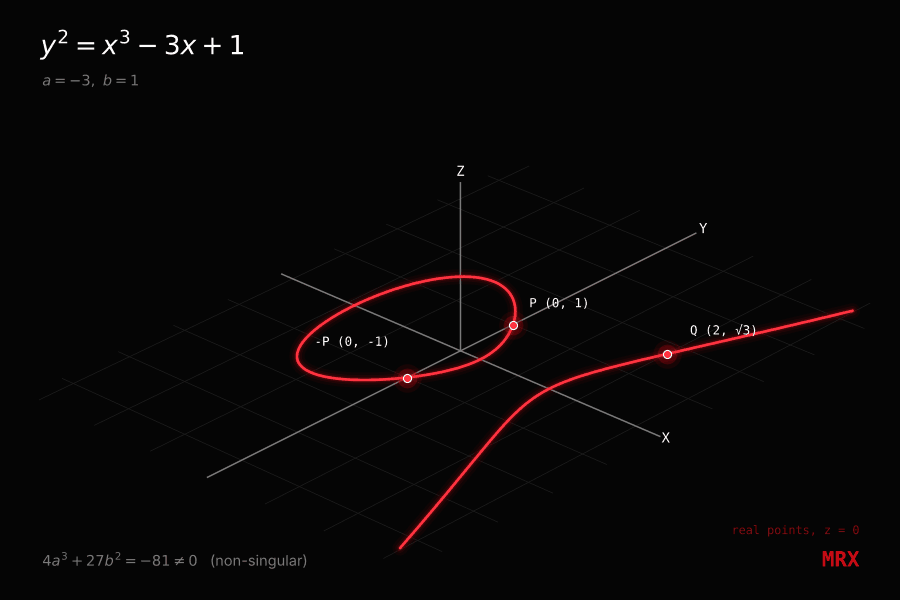

<div align="center">


[](https://git.io/typing-svg)


<p align="center">
  
  <br>
  <sub><i>y² = x³ - 3x + 1 · real points of a non-singular elliptic curve</i></sub>
</p>

**[ABOUT](#about)** · **[FOCUS](#focus-areas)** · **[ARSENAL](#skills--arsenal)** · **[TOOLBOX](#toolbox)** · **[CTF](#ctf--achievements)** · **[STATS](#stats)** · **[CONTACT](#find-me)**

</div>

---

## ABOUT

```
 ███▄ ▄███▓ ██▀███  ▒██   ██▒
▓██▒▀█▀ ██▒▓██ ▒ ██▒▒▒ █ █ ▒░
▓██    ▓██░▓██ ░▄█ ▒░░  █   ░
▒██    ▒██ ▒██▀▀█▄   ░ █ █ ▒ 
▒██▒   ░██▒░██▓ ▒██▒▒██▒ ▒██▒
░ ▒░   ░  ░░ ▒▓ ░▒▓░▒▒ ░ ░▓ ░
░  ░      ░  ░▒ ░ ▒░░░   ░▒ ░
░      ░     ░░   ░  ░    ░  
       ░      ░      ░    ░  
```

```bash
[mrx@arch ~]$ whoami
mrx
[mrx@arch ~]$ cat /etc/profile
> Initializing profile...
> Loading credentials...
> Access granted. Welcome, MRX.
```

```python
class MRX:
    def __init__(self):
        self.name       = "MRX."
        self.role       = "Cybersecurity Researcher."
        self.interests  = [
            "Binary Exploitation.",
            "Web Exploitation.",
            "Reverse Engineering.",
            "CTF Challenges.",
            "Linux Internals.",
        ]
        self.os         = "Arch Linux."
        self.tools      = ["GDB", "pwndbg", "radare2", "ROPgadget"]
        self.motto      = "Turn fear into boredom."
```

<details>
<summary><b>[+] Currently exploring: elliptic curves</b></summary>

<br>

The animation above shows the real points of `y² = x³ - 3x + 1`, drawn on the plane `z = 0`.

| Item | Value |
|---|---|
| Curve | `y² = x³ + ax + b`, with `a = -3`, `b = 1` |
| Non-singular | `4a³ + 27b² = -81 ≠ 0` |
| Points | `P = (0, 1)`, `-P = (0, -1)`, `Q = (2, √3)` |

This is a geometric picture over the reals. It is not a curve over a finite field `F_p`, which is what real ECC uses.

</details>

---

## FOCUS AREAS

```
[+] Binary Exploitation ██████████████░░░░░░  70%
[+] Web Exploitation    ███████████████████░  95%
[+] Reverse Engineering ███████████████░░░░░  75%
[+] Cryptography        ███████████████████░  95%
[+] Network Analysis    ██████████████████░░  90%
```

---

<div align="center">

## SKILLS & ARSENAL


</div>

---

## TOOLBOX

| Category | Tools |
|---|---|
| **Binary Exploitation** | `pwntools` `GDB` `pwndbg` `peda` `ROPgadget` `checksec` |
| **Web Exploitation** | `sqlmap` `ffuf` `nikto` `gobuster` |
| **Reverse Engineering** | `Ghidra` `Binary Ninja` `radare2` `strings` `ltrace` `strace` |
| **Linux** | `bash` `kate` `tmux` `strace` `gdb` `valgrind` |
| **Network** | `Wireshark` `nmap` `netcat` `tcpdump` |

---

## CTF & ACHIEVEMENTS

```bash
[mrx@arch ~]$ ls -la ./ctf/trophies/
```

```
drwxr-xr-x  pwn/         <- Buffer overflows, ROP chains, heap exploitation.
drwxr-xr-x  web/         <- SQLi, XSS, SSRF.
drwxr-xr-x  rev/         <- Crackmes, malware analysis, obfuscation.
drwxr-xr-x  misc/        <- Forensics, steganography, crypto, network.
```

> *"There are only two types of systems: those that have been compromised, and those that don't know it yet."*

---

## STATS

<div align="center">


</div>

---

<div align="center">

## FIND ME

[](https://github.com/iwashiiro)

```bash
[mrx@arch ~]$ echo "Stay curious. Break things. Learn everything."
Stay curious. Break things. Learn everything.
[mrx@arch ~]$ _
```


</div>
